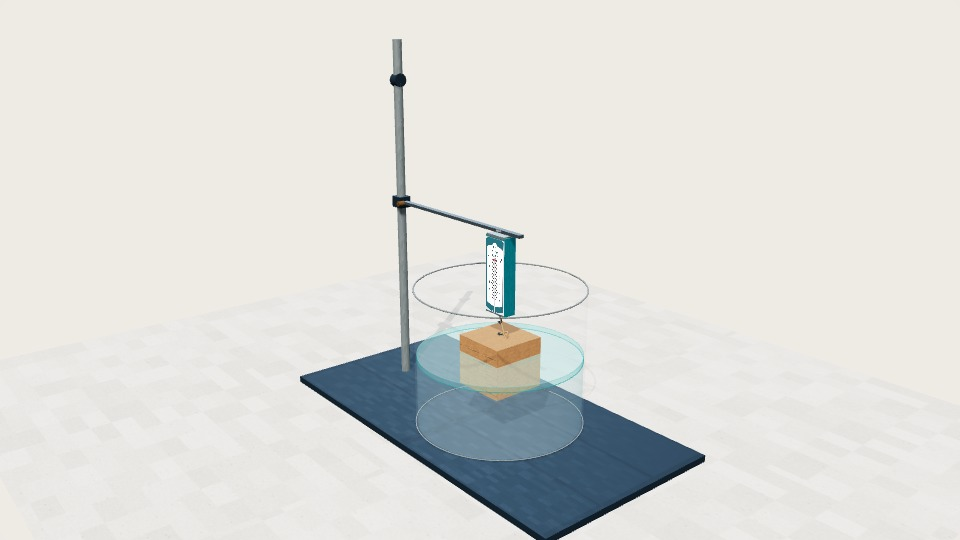
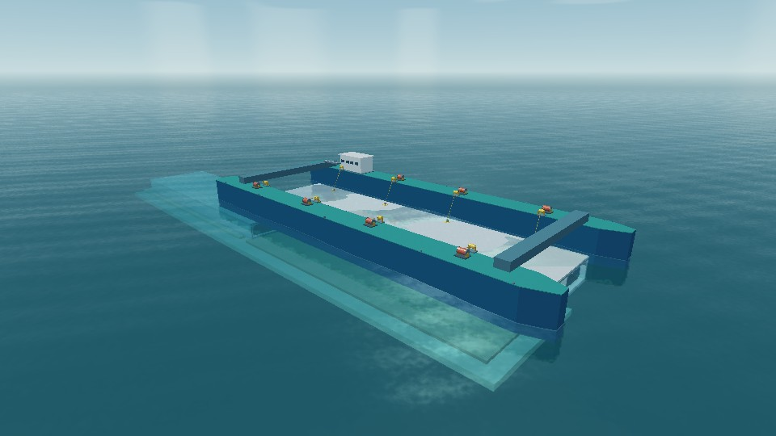
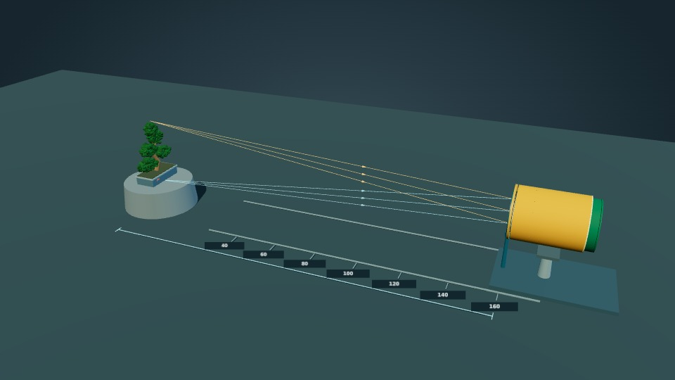

# 3D 交互物理实验室

**让物理知识从静态插图变成可观察、可操作、可验证的交互实验。**

面向初中物理课堂与自主探究的 3D 教学作品集：通过 **Three.js / WebGL、SVG、Canvas** 等技术，把实验器材的结构、实验现象的变化过程与物理量之间的关系呈现在浏览器中。部分案例使用 React、PBR 材质及 Blender / glTF 模型；不同案例的实现方式并不完全相同。

**当前案例：64 个 · 14 个分类**（统计自 `catalog.js`，截至 2026-10-30）

[查看作品集入口](./index.html) · [浏览完整案例目录](#完整案例目录) · [快速开始](#快速开始) · [新增案例](#新增案例与维护)

> 本项目强调**结构准确、运动连贯、物理关系可信、课堂表达清晰**。模型中的剖切、示踪、慢放、颜色增强及局部比例放大，可能用于教学说明；它们不一定等于真实器材的外观、尺寸或实验观测值。

## 场景预览

| **浮力与密度实验室** | **深中通道 E15 沉管安装** | **纸筒照相机与调焦** |
| --- | --- | --- |
| [](./models/buoyancy-density-lab.html) | [](./models/shenzhong-e15.html) | [](./models/paper-tube-camera.html) |

*预览图使用仓库中现有的案例封面；点击图片可查看对应 HTML 源文件。在 GitHub 文件页面直接点击 HTML 不等于运行交互演示。*

## 为什么做这个项目？

- **看清结构**：旋转、缩放、平移、剖切或拆解仪器，解释外部看不到的连接和动作。
- **看见过程**：用连续动画呈现加热、液面变化、光路、机械传动及工程施工阶段。
- **建立联系**：将三维装置与示数、受力图、电路图、实验图像等联动，帮助学生从现象走向规律。
- **便于课堂使用**：按需加载独立案例；从作品集搜索进入，也可在新标签页打开，适合投影演示和学生探索。

## 代表案例

| 案例 | 课堂探究重点 |
|:---|:---|
| [浮力与密度实验室](./models/buoyancy-density-lab.html) | 五种实验联动受力图、曲线与三维装置 |
| [弹簧测力计（三种结构）](./models/spring-force-meters.html) | 加载、剖切、分解和矢量刻度读数 |
| [光与光谱](./models/light-spectrum-color-vision.html) | 三棱镜色散、滤光片和物体颜色 |
| [纸筒照相机](./models/paper-tube-camera.html) | 伸缩调焦与清晰成像的同尺度对比 |
| [钱塘江大桥施工](./models/qiantang-bridge-complete.html) | 四阶段施工过程与潮汐落梁 |
| [深中通道 E15](./models/shenzhong-e15.html) | 沉管浮运、沉放、对接与回填 |
| [CR400AF 高铁持续取电](./models/cr400af-railway-power.html) | 受电弓、接触网与张力补偿机构联动 |
| [DZ47 系列参考断路器](./models/dz47-breaker.html) | 单极教学近似：热磁脱扣，非原厂 CAD |
| [三脚插头](./models/three-pin-plug.html) | 观察保护接地的先接通、后断开 |

更完整的实验入口、关键词与分类筛选以 [作品集首页](./index.html) 和 [`catalog.js`](./catalog.js) 为准。

## 完整案例目录

作品集中的 63 个正式入口均由 `catalog.js` 登记。下列列表按现有分类分组；点击分类可展开。

| 分类 | 数量 | 分类 | 数量 |
|:---|---:|:---|---:|
| 热学实验 | 5 | 光学现象 | 8 |
| 光学仪器 | 3 | 力学实验 | 18 |
| 综合应用 | 8 | 电学元件 | 7 |
| 电学实验 | 2 | 声学与电磁 | 5 |
| 能源与发电 | 3 | 家庭电路 | 1 |
| 通信与信息 | 1 | 精密机械 | 1 |
| 光与视觉 | 1 | 生活中的物理 | 1 |

<details>
<summary><strong>热学实验（5）</strong></summary>

- [干湿球温度计 · 蒸发吸热与空气湿度](./models/wet-dry-bulb-psychrometer.html) — 双温度计、湿球纱布供水、读数联动、湿度估算与局部放大（单文件离线）
- [温度计与热膨胀 · 九种结构探究](./models/thermometers-thermal-expansion.html) — 水银狭道、双金属片、波登管、金属杆与两种空气温度计（单文件离线）
- [海波与石蜡 · 熔化与凝固实验室](./models/melting-freezing-lab.html) — 水浴加热、物态显色与熔化凝固曲线
- [观察水沸腾 · 三维精密实验室](./models/water-boiling.html) — 酒精灯加热 · 气泡演化 · 分层水温 · 余热冷却
- [水与食用油 · 比较吸热能力](./models/specific-heat-water-oil.html) — 双杯同步加热 · 温度—时间图像 · 吃包子大赛

</details>

<details>
<summary><strong>光学现象（8）</strong></summary>

- [光与光谱 · 色散、滤光与物体颜色](./models/light-spectrum-color-vision.html) — 三棱镜色散 · 可见与不可见光 · 滤光片 · 物体颜色
- [凹透镜成像规律](./models/concave-lens.html) — 正立缩小虚像与三条特殊光线
- [光的反射与折射](./models/reflection-refraction.html) — 平面实验、光路可逆与空间拓展
- [海市蜃楼](./models/mirage.html) — 上蜃、下蜃与弯曲光路
- [平面镜成像规律](./models/plane-mirror.html) — 玻璃板、等大蜡烛与像的位置探究
- [凸透镜成像规律](./models/convex-lens.html) — 3D光具座与2D光路联动实验
- [小孔成像 · 自由探究](./models/pinhole-camera.html) — 孔径、孔形、物距与像距的三维观察
- [月光下的积水 · 光的反射](./models/moonlight-puddle.html) — 迎月与背月 · 镜面反射和漫反射

</details>

<details>
<summary><strong>光学仪器（3）</strong></summary>

- [纸筒照相机 · 伸缩调焦](./models/paper-tube-camera.html) — 靠近与远离拍摄 · 像高测量与同尺度对比
- [折射式天文望远镜](./models/refracting-telescope.html) — 开普勒式 · 焦平面实像与目镜调焦
- [牛顿式反射望远镜](./models/reflecting-telescope.html) — 凹面主镜 · 45°副镜 · 侧置目镜

</details>

<details>
<summary><strong>力学实验（18）</strong></summary>

- [大气压与按压泵](./models/pressure-pumps.html) — 洗手液泵与气囊取水器 · 双案例剖面
- [绿豆密度 · 等体积替代](./models/mung-bean-density.html) — 四步实验、四次称量与物理量总览
- [弹簧测力计 · 三种结构](./models/spring-force-meters.html) — 圆筒式、条形盒式与开放式
- [深中通道 E15 · 沉管浮运安装](./models/shenzhong-e15.html) — 十阶段施工演示 · 分阶段自动跟随镜头
- [浮力与密度实验室](./models/buoyancy-density-lab.html) — 标准实验、溢水杯、剪绳、底部拴绳与套杯托起
- [托盘天平 · 质量测量](./models/tray-balance.html) — 手动调零、砝码与游码配平、读数及误差
- [筒车灌田 · 机械能转化](./models/water-wheel.html) — 水流驱动、竹筒提水与梯田灌溉
- [阿基米德原理](./models/archimedes-principle.html) — 排水称重实验
- [微小压强计](./models/micro-pressure-gauge.html) — 橡皮膜、开口玻璃管与气流侧向取压
- [手压抽水机](./models/piston-pump.html) — 引水、密封与两个单向阀的自由探究
- [测量小车的平均速度](./models/car-speed.html) — 斜面小车、机械秒表与误差探究
- [滑动摩擦力演示仪](./models/friction-belt.html) — 传送带 · 二力平衡 · 弹簧测力计
- [探究滑动摩擦力 · 手动拉动](./models/friction-manual-step.html) — Blender V9 · 弹簧测力计 · 静止到滑动
- [古代杠杆工坊](./models/ancient-levers.html) — 桔槔、踏碓与单碓／四碓水力机械
- [潜水钟 · 空气与水压](./models/diving-bell.html) — 前海傍晚海岸中的存气、补气与水压观察
- [滑轮实验室](./models/pulley-lab.html) — 定滑轮、动滑轮、滑轮组与等效杠杆
- [烧瓶潜水艇](./models/flask-submarine.html) — 双管烧瓶的进排水与浮沉
- [重力输液 · 玻璃瓶与软袋](./models/gravity-infusion.html) — 独立进气、袋壁收缩与压差驱动

</details>

<details>
<summary><strong>综合应用（8）</strong></summary>

- [高铁，如何持续取电 · CR400AF](./models/cr400af-railway-power.html) — 受电弓升降、弓网接触、张力补偿与棘轮断线制动
- [自制气压计、温度计与微小形变](./models/capillary-three-experiments.html) — 玻璃瓶细管装置的三种物理探究
- [钱塘江大桥 · 四阶段完整施工](./models/qiantang-bridge-complete.html) — 射水打桩 → 沉箱浮运 → 压气筑墩 → 钢梁落潮架设
- [油量测量装置](./models/fuel-gauge.html) — 浮子—滑杆—变阻器联动
- [压力电子秤](./models/pressure-scale.html) — 压敏电阻、双电表与称重机构联动
- [身高体重测量仪](./models/height-weight-meter.html) — 测高、称重双支路与电表示数
- [文物展台防盗报警装置](./models/museum-alarm.html) — 弹簧触点、短路旁路与电铃报警
- [水位自动报警器](./models/water-level-alarm.html) — 水位、继电器与红绿信号灯联动

</details>

<details>
<summary><strong>电学元件（7）</strong></summary>

- [DZ47 系列参考 · 单极断路器内部结构](./models/dz47-breaker.html) — 教学近似模型｜非原厂精确复刻；支持热磁脱扣演示
- [三脚插头 · 地线先通后断](./models/three-pin-plug.html) — 隐藏外壳观察插脚与夹片的接触顺序
- [瓷底双刀闸刀开关](./models/porcelain-knife-switch.html) — 双刀联动、熔断连接片与瓷底装配结构
- [2×AA 电池盒](./models/battery-box.html) — 外壳、底座与串联结构
- [电位器](./models/potentiometer.html) — 旋钮、滑片与分压结构
- [滑动变阻器](./models/rheostat.html) — 清晰环形接线、指针读表与灯泡亮度
- [电阻箱与插塞式电阻器](./models/resistance-boxes.html) — 旋转触片、插塞短路与接入阻值

</details>

<details>
<summary><strong>电学实验（2）</strong></summary>

- [地磅 · 载重与电流](./models/weighbridge.html) — 弹簧、滑片与电流表联动
- [焦耳定律](./models/joule-law.html) — 比较电阻与电流对电热的影响

</details>

<details>
<summary><strong>声学与电磁（5）</strong></summary>

- [地球磁场 · 指南针探究](./models/earth-magnetism.html) — 任意位置安放指南针，观察磁偏角与磁倾角
- [安培定则](./models/ampere-rule.html) — 机器人右手握持与螺线管磁极判断
- [电动机原理 · 四个3D实验](./models/motor-principles.html) — 导体受力、手动换向、刮漆与换向器
- [扬声器结构与振动](./models/speaker.html) — 纸盆、音圈与磁隙的装配关系
- [动圈式话筒](./models/dynamic-microphone.html) — 金属网罩、膜片与动圈拾音单元

</details>

<details>
<summary><strong>能源与发电（3）</strong></summary>

- [单缸四冲程汽油机](./models/four-stroke-engine.html) — 观察冲程、曲轴转数与能量转化
- [核能发电](./models/nuclear-power.html) — 反应堆、汽轮机与发电机
- [塔式太阳能电站](./models/solar-tower.html) — 参照敦煌 100 MW 熔盐塔式光热电站

</details>

<details>
<summary><strong>家庭电路（1）</strong></summary>

- [螺口灯泡装配与接线](./models/e27-bulb.html) — E27 灯泡、灯座与家庭电路

</details>

<details>
<summary><strong>通信与信息（1）</strong></summary>

- [通信卫星与全球通信](./models/communication-satellite.html) — 同步卫星、天宫空间站与天地通信

</details>

<details>
<summary><strong>精密机械（1）</strong></summary>

- [机械秒表（停表）](./models/stopwatch.html) — 装配、分解与计时机构

</details>

<details>
<summary><strong>光与视觉（1）</strong></summary>

- [眼睛的调节与视角](./models/eye-accommodation.html) — 晶状体调焦、视网膜成像与可辨细节

</details>

<details>
<summary><strong>生活中的物理（1）</strong></summary>

- [地漏存水杯与水封](./models/floor-drain-trap.html) — 连通器 · 剖面 · 排水防臭

</details>

> 目录根据 **2026-10-30 仓库实况**生成。部分旧文件、实验性原型和重定向入口保留在 `models/` 中，但不计入正式案例数量。例如钱塘江大桥的正式入口为 `qiantang-bridge-complete.html`，旧入口用于兼容历史链接。

## 快速开始

### 方式一：本地运行（推荐）

无需安装前端构建依赖，也不必安装 React 或 Three.js 的 npm 项目。仓库入口是静态网页。

```bash
git clone https://github.com/zmdyy/3Dmodel2.git
cd 3Dmodel2
python -m http.server 8000
```

打开 **http://localhost:8000/**，在首页搜索、筛选并进入案例。

没有安装 Python 也可以使用 VS Code 的 **Live Server** 或其他静态 HTTP 服务器。**Python 不是浏览案例的运行时依赖**；上面的命令仅用于启动本地文件服务器。

不建议直接通过 `file://` 双击作品集主页运行全部案例：浏览器对 GLB、纹理、模块脚本和跨文件请求可能施加安全限制。

### 方式二：静态网站部署

本仓库使用相对路径组织资源，可部署到 **GitHub Pages** 或其他静态文件服务器。部署目录必须包含 `index.html`、`catalog.js`、`models/`、`shared/`、`assets/` 等资源；**仅上传首页 HTML 并不能运行所有案例**。GitHub Pages 的开启状态和实际站点地址以仓库设置为准。

### 离线使用边界

- **CR400AF 案例**：案例库版 `cr400af-railway-power.html` 按相对路径加载 `cr400af-railway-power-assets/` 中的本地资源分包，需要将资源目录一同部署到静态服务器；用户提供的原始版本仍为单文件离线 HTML。

- **整仓本地部署**：下载完整仓库，在断网环境用本地 HTTP 服务器运行；仍需逐一确认所选案例没有外部 CDN/API 请求。
- **单文件离线分享**：只有已将脚本、纹理、模型等依赖完整内嵌的案例才能直接作为单个 HTML 使用。仓库里的普通 `models/*.html` **不保证**全部具备这种能力。
- **浏览器环境**：推荐新版 Chrome / Edge；三维案例需要 WebGL 支持。大型场景可能对显卡性能有较高要求。

## 操作说明

| 操作 | 通常用于 |
|:---|:---|
| 鼠标左键拖动 | 旋转三维视角（拖动可操作零件时以实验交互为准） |
| 滚轮 / 双指缩放 | 放大或缩小 |
| 鼠标右键拖动，或 Shift + 左键拖动 | 平移观察视角 |
| 复位、剖切、局部放大、播放、暂停等 | 由各个案例的页面按钮提供 |

部分二维图表和特殊实验有自己的操作方式。统一视角设计参见 [导航约定](./docs/navigation.md)。

## 技术与目录

```text
3Dmodel2/
├── index.html              # 作品集入口：搜索、分类、案例查看器
├── catalog.js              # 正式案例元数据（单一入口清单）
├── models/                 # 独立 HTML、配套 JS 和部分 GLB
├── assets/covers/          # 案例封面及截图
├── shared/                 # 公共材质、导航、实验模块和 Three.js 资源
│   └── vendor/             # 部分本地 Three.js 版本及许可
├── docs/                   # 各案例的原理、验收与边界说明
├── scripts/                # 案例导入、封面捕获和检查脚本
├── MATERIALS.md            # 材质与质感约定
└── README.md
```

**架构原则：** `index.html` 根据 `catalog.js` 生成卡片；仅当打开案例时，才加载相应的独立页面。关闭查看器后会卸载该 iframe，避免主页同时维持多个 WebGL 场景。不同案例可以使用不同 Three.js 版本或二维方案，不需要把全部代码合并成一个应用。

**公共规范：** [材质规范](./MATERIALS.md) · [三维导航](./docs/navigation.md) · [封面来源](./docs/gallery-covers.md) · [历史开发记录](./docs/README_HISTORY_2026-10-29.md)

## 新增案例与维护

1. **核实对象**：先确认装置结构、连接关系、运行过程与物理原理；找不到充分依据的细节应标记为教学近似。
2. **明确脚本**：写出实验阶段、状态变化、参数范围、教学重点和验收条件。
3. **制作并验收局部**：使用 Three.js、SVG、Canvas 或 Blender / glTF 构建关键部件，优先检查比例、接触关系、光路及运动连续性。
4. **集成为独立案例**：保存为 `models/<ascii-id>.html`，确有必要时将公共模块放入 `shared/`。稳定 ID 使用小写字母、数字及连字符。
5. **登记作品集**：在 `catalog.js` 添加 `id`、`title`、`subtitle`、`category`、`summary`、`tags`、`path`、`symbol`、`accent`，如有真实案例封面再添加 `cover`。
6. **核对体验**：检查搜索与分类、默认视角、旋转/缩放/平移、动画与物理量同步、透明度和遮挡、移动端与浏览器加载；通过后再提交。

可使用辅助脚本创建入口：

```bash
python scripts/add-model.py ./新案例.html --id new-demo --category 力学实验 --tags 密度,测量
```

**注意：** 当前 `scripts/add-model.py` 检测到特定内嵌 Three.js r144 时，会替换为 **jsDelivr CDN 地址**，并非自动改成本地 `shared/vendor/` 引用。需要离线发布时，请检查并改为本地依赖或生成完整内嵌版本，不能只依赖脚本输出。

案例封面应优先使用实际运行画面的截图，不使用与案例内容不一致的装饰图。截图与工作流示例见 [封面文档](./docs/gallery-covers.md)。

## 准确性、使用范围与版权

- 这是**教学交互演示**，不是测量仪器校准软件、施工指导、设备选型或工业级 CAD。部分工程场景采用压缩距离、放大运动、状态示踪等教学处理。
- 例如 [DZ47 系列断路器](./models/dz47-breaker.html) 当前为**单极热磁脱扣教学近似模型**，并非已核验的原厂 1:1 制造图；双极联动版尚未完成。更多限制详见 [案例说明](./docs/dz47-breaker.md)。
- 项目使用的第三方库、纹理、参考素材应遵守各自的许可及署名要求；本仓库包含部分 Three.js 的 [MIT 许可文本](./shared/vendor/THREE-LICENSE.txt)。**仓库公开可见不等同于所有素材均可自由商用或二次分发**，使用前请核对相应授权。
- 早期 README 中按案例累积的实现记录已保存在 [历史开发记录](./docs/README_HISTORY_2026-10-29.md)；新的 README 专注于项目介绍、导航与使用方式。

---

**项目地址：** [github.com/zmdyy/3Dmodel2](https://github.com/zmdyy/3Dmodel2)  
**资料反馈：** 欢迎通过 [Issues](https://github.com/zmdyy/3Dmodel2/issues) 提交模型结构、教学原理、加载与交互问题。
