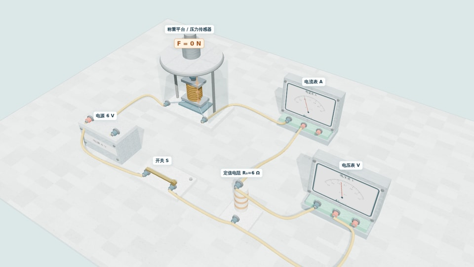

# 压力电子秤 · 三维实物接线（V3）

[返回作品集](../index.html) · [打开案例](../models/pressure-scale.html) · [查看浏览器验收脚本](../scripts/check-pressure-scale.cjs)

## 教学目标

通过可旋转的装置、七根固定导线、两只测量仪表和压力—物理量曲线，观察**压力增大 → 压敏电阻减小 → 电流增大 → 定值电阻两端电压增大**。页面按实验操作、图像分析、实物接线三个区域组织，不需同时阅读所有文字说明。

## 已实现

- Three.js r144 WebGL 场景与 PBR 质感：重调灯光与色调映射，改善底板、金属、透明材料的层次，降低整体发白。
- 称重机构：移动托盘、传力杆、压板、螺旋弹簧、传感器与承重底座。修正弹簧上下连接，使其随模拟载荷连续压缩；**机械压缩幅度为教学放大，不是某款真实电子秤的尺寸数据**。
- 电学部分：6 V 电源，6 Ω 定值电阻，压敏电阻 R(F)，电流表使用 0–0.6 A，电压表使用 0–3 V，并联在定值电阻两端。
- 交互：压力滑条和六个节点按钮；开关直接点击或按钮操作；三维旋转、平移、缩放、视角平滑切换、透明观察、电流箭头、PNG 导出。
- 教学面板：实验操作、图像分析、实物接线三页切换；实时计算展示 R、I、U₀；R–F 与 U₀–F 曲线；更大更清楚的仪表刻度和超量程状态。
- 导线从固定端子接线；**浅橙色线为导线，红色箭头为约定电流**；电压表支路理想情况下无电流箭头。

## 电路连接

主回路：**E+ → S1 → S2 → P → R₀ → Q → A(0.6) → A− → R2 → R1 → E−**。

电压表：**V3 → P、V− → Q**。电流表 3 A、 电压表 15 V 接线柱留空。7 根导线的具体序号见案例内的「实物接线」页。

计算基于理想电学元件，不考虑电源内阻和导线电阻：

```text
R_total(F) = R(F) + R₀
I = E / R_total(F) = 6 / [R(F) + 6]
U₀ = I × R₀ = 36 / [R(F) + 6]
```

## 题目数据

| F / N | 0 | 200 | 300 | 600 | 800 | 1000 |
|---:|---:|---:|---:|---:|---:|---:|
| R / Ω | 24 | 14 | 12 | 6 | 4 | 3 |

非表中节点使用**分段线性插值**，并非某个真实压敏元件的实测材料曲线。

| 状态 | I | U₀ | 量程判断 |
|---|---:|---:|---|
| F=0 N，闭合 | 0.200 A | 1.20 V | 安全 |
| F=300 N，闭合 | 0.333 A | 2.00 V | 安全 |
| F=600 N，闭合 | 0.500 A | 3.00 V | 电压表达到上限 |
| F=1000 N，闭合 | 0.667 A（理论） | 4.00 V（理论） | 两表均超量程 |
| 开关断开 | 0 A | 0 V | 无主回路电流 |

**600 N** 是这里的最大安全压力。在更大的压力下，曲线可继续显示理想电路的理论值，但**不能把超过仪表量程的数值当成真实的可测示数**；三维表盘在机械上限停住并显示超量程警告。

## 课堂建议

1. 保持 0 N、闭合开关，观察仪表起始位置；注意电压表此时读数不是 0 V。
2. 分别选择 200、300 N，询问同学三个物理量如何变化。
3. 选择 600 N，明确电压表先达到上限，解释为何不能只看电流表。
4. 断开开关后再调整到 800、1000 N，对照理论曲线与实际量程。
5. 打开接线页追踪主回路和并联支路，核对电流流动方向。
6. 用近看传感器和近看仪表按钮检查构件关系与读数。

## 验收记录（2026-10-29）

仓库中的 [Playwright Chromium 检查脚本](../scripts/check-pressure-scale.cjs) 已在 GitHub Actions 的软件 WebGL 环境运行，检查包括：画布加载、0/300/600/1000 N 电学计算、超量程提示、断开开关、复位、三条图像曲线、面板切换、电路图和浏览器脚本错误，共 **16 项通过**。场景封面使用该浏览器中实际渲染的三维画面生成：

[](../models/pressure-scale.html)

注意：自动化结果不等于真实仪器或工业装配精度认证。**真实物理结构仍为教学近似建模**，对机械间隙与实验误差的验证需结合实物进行。
