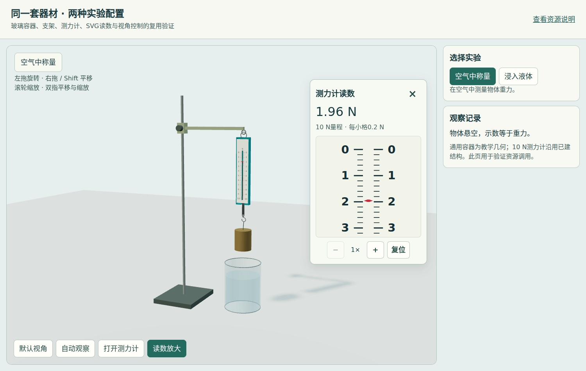
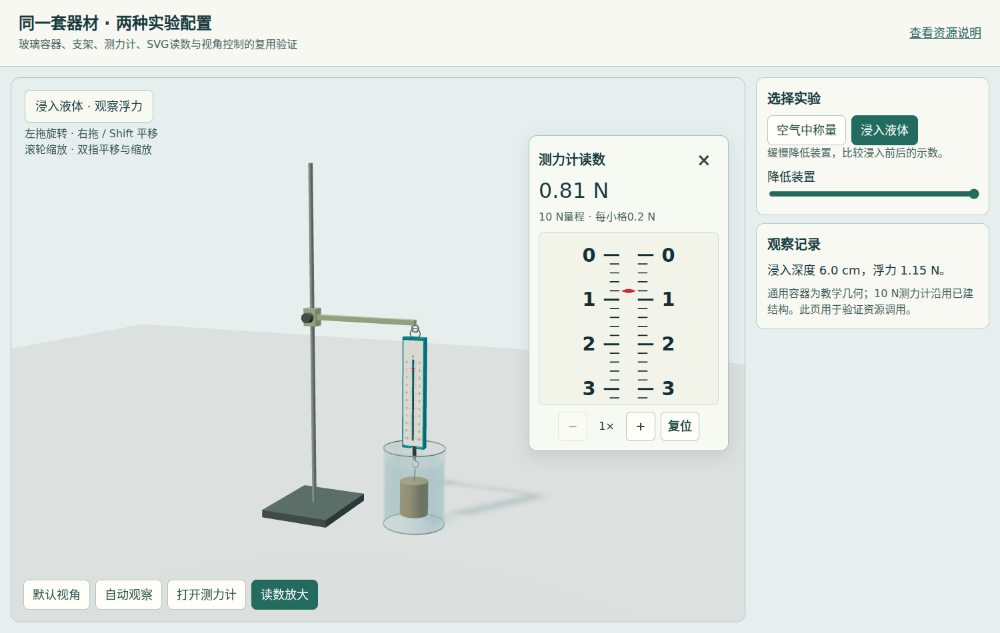

# 复用资源验收记录

资源包1.2.1，2026-10-31。9项公共资源及三类放大样式。

## 恢复说明

之前尚未发布的工作目录被维护清理，未找到完整备份。本版依据对话中保留的实现、已确认接口及原仓库案例恢复源码，重新执行验证；不是找回原来未发布提交的逐字节副本。注册表记录当前原案例提交和源文件哈希，measurement-1参考片段冻结自`8cd976dd4764eed2fad424de73478899bee2262f`。

## 验收范围

- 本地单元检查：测力计0/2.4/10 N行程、弹簧几何、两实例隔离、剖切恢复、越界输入；杯内液面、空水隐藏、支架挂接点。
- 控制：模拟旋转、屏幕平移、双指重心平移与捏合、抬指无跳变、手动接管与恢复；横竖屏8角点相机拟合。
- SVG：刻度校准、转义、2/5/10 N类型、唯一clip/gradient ID；红指针与黑刻度留白。
- AI：中文检索、依赖、源哈希、接口示例、不兼容引擎拒绝；候选资源明确标记。
- 浏览器/WebGL：称量和浸入、排液与示数同步、模式往返8次无实例残留、局部窗拖动/缩放/复位/关闭重开、焦点和倍率保留、零点3倍不丢指针、内容适配清理。
- 七个镜头机位和完整28秒真实rAF自动观察；390px无横向溢出、放大窗移到主画面下方。
- 两个单文件用file方式打开并拦截HTTP/HTTPS；检查无外部请求。measurement-1主图与局部同时应用窄指针修复。

命令：

```bash
python scripts/reuse-context.py --validate
node scripts/tests/lab-kit.cjs
node scripts/tests/reuse-browser.cjs
node scripts/tests/instrument-patterns.cjs
```

Playwright来自`LAB_KIT_NODE_MODULES`或运行时依赖；浏览器可通过`LAB_KIT_CHROMIUM`指定。`LAB_MEASUREMENT_SOURCE`可指向原measurement-1的本地index.html追加原页面检查。不具备浏览器不能以静态检查冒充画面验收。

实际运行结果见 [validation.json](../../assets/reuse-evidence/validation.json) 和 [instrument-patterns-validation.json](../../assets/reuse-evidence/instrument-patterns-validation.json)。

| 称量 | 浸入 |
|---|---|
|  |  |

[三类样式](../../assets/reuse-evidence/instrument-patterns.png) · [窄屏](../../assets/reuse-evidence/narrow-layout.png) · [原测力计修正](../../assets/reuse-evidence/measurement-fixed-pointer.png)

## 仍需单独验证

用户确认的是三类样式偏好，不是全部新器材和设备。真实手机触屏、教室投影和目标Windows字体仍需实机检查。套杯、新背景、新引擎及尚未独立提取的温度计/酒精灯等不能继承本轮结论。旧正式案例没有批量切换到新组件。
