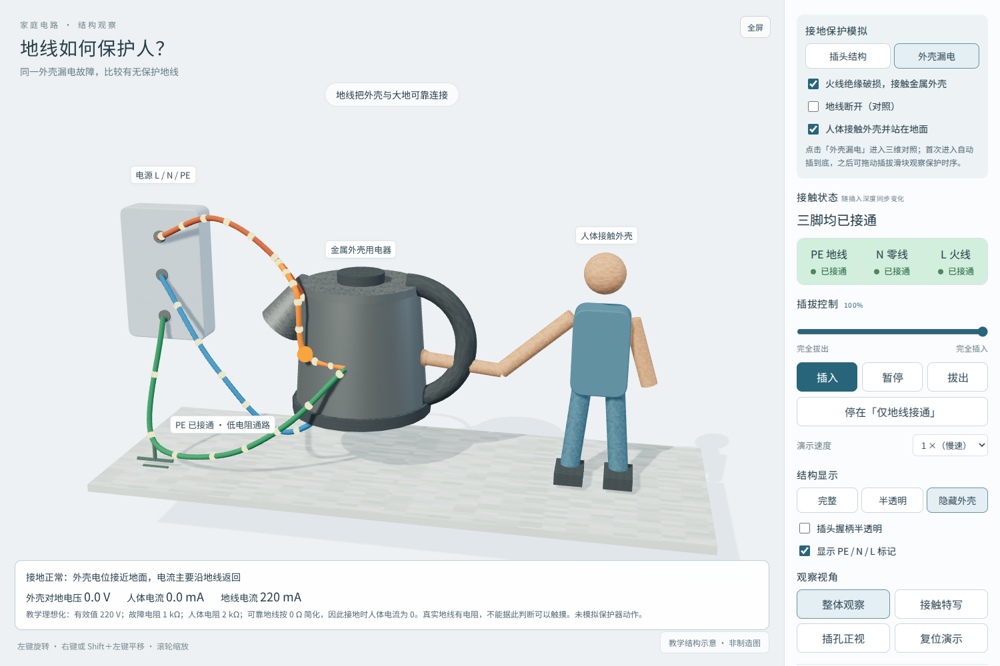
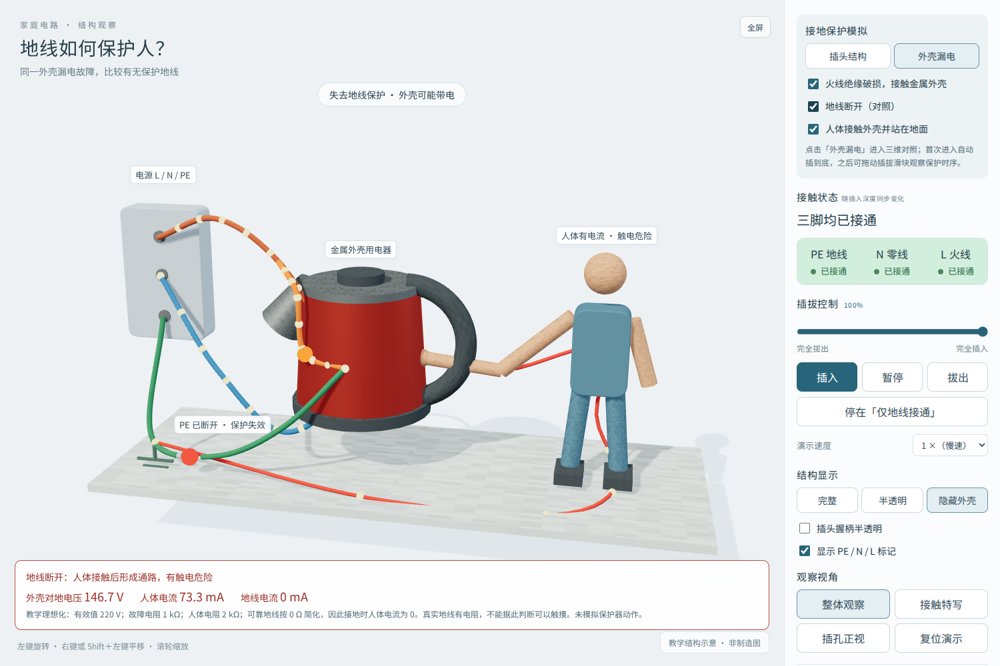

# 三脚插头：外壳漏电与保护接地

| 项目 | 实现 |
| --- | --- |
| 教学目标 | 同一绝缘故障下，对比地线有效与断开时的外壳电位、人体电流；联系插拔时地线先通后断。 |
| 引擎与资源 | 沿用本地 Three.js r160、material-finish.js、navigation-style.js；不新增公共器材 API。原插头毫米几何保留；新增场景尺寸为示意比例，电学量使用 V/A/Ω。 |
| 连接 | L 经负载回 N；故障电阻连接 L 与金属外壳；PE 把外壳连接电源接地点；人体接触时为外壳至地面的独立支路。人体不串接在 PE 中。 |
| 参数与公式 | U=220 V（有效值），故障电阻 Rf=1000 Ω，人体 Rb=2000 Ω。可靠 PE 理想化为 0 Ω；接地时 Ucase=0，Ib=0，Ipe=U/Rf。PE 断开且接触时 Ib=U/(Rf+Rb)，Ucase=Ib×Rb；未接触时 Ucase=U，Ib=0。L 断开时上述故障电流均为零。 |
| 简化 | 纯电阻稳态示意，交流粒子用于表示通路，不表示电子持续单向运动。未模拟保护器动作、地电位上升、人体电容和多处漏电。不得理解为实际接地时可以触摸漏电设备。 |
| 统一状态 | solveGrounding 由插脚接触、绝缘故障、地线断开、人体接触四项条件求解；外壳颜色、粒子、标签及读数使用相同结果。 |
| 操作 | 首次切换自动插到底；后续保留插拔深度。原插头结构/显示/镜头保留；模拟使用独立全景，继续支持原有旋转、平移、缩放。 |
| 新增模型 | 示意金属电热水壶、人体、电源端子、地线和故障支路；不声称复刻特定电器产品。 |

原理依据：Schneider Electric [How does RCD work?](https://www.se.com/nz/en/faqs/FAQ000210095/) 中的相线—故障—保护导体/大地返回路径，仅用作接地回路依据。本案例按用户要求不添加 RCD 跳闸。

## 验收（2026-11-03）

- `node scripts/tests/three-pin-plug-grounding.cjs`：通过。实际 Chromium/WebGL、file://、拦截全部 HTTP(S)；接地/断地/接触/未接触/无故障、PE 与 L/N 精确接触边界、返回结构/复位、390px 布局均通过；无页面脚本错误、无联网请求。
- `node scripts/tests/reuse-browser.cjs`：通过。
- `node scripts/tests/instrument-patterns.cjs`：通过。
- `python scripts/reuse-context.py --validate` 与 `node scripts/tests/lab-kit.cjs`：被仓库已有温度计源码哈希记录不一致阻断（`models/thermometers-thermal-expansion.html`）；本次未修改该文件或注册表。
- 视觉检查：桌面接地与断地、390px 页面，模型、标签、读数均可见。宿主 Linux 无中文字体，截图检查临时注入本地 Noto Sans SC；案例本身沿用仓库中文系统字体栈，无网络字体依赖。

